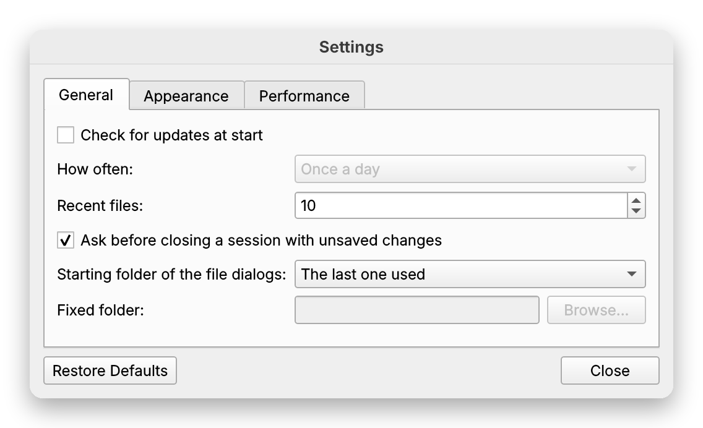
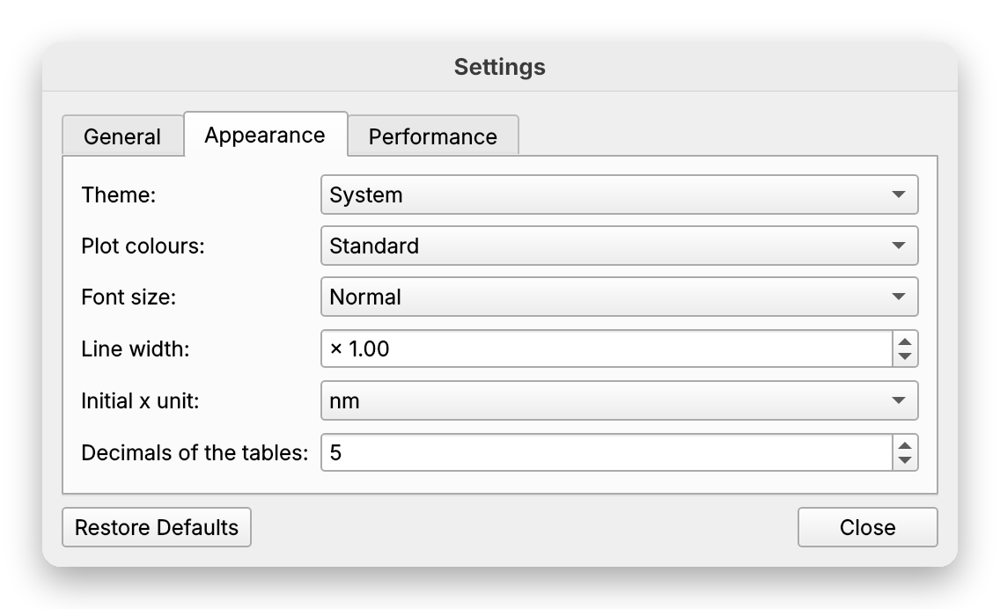
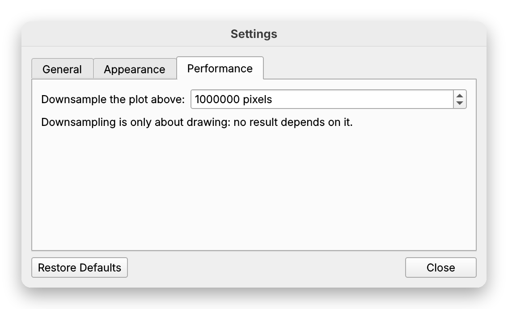

# Settings

*Edit > Settings...* (on macOS *Astrocook > Settings...*, or `Cmd+,`) opens
the settings of the interface, in three tabs. Every change
applies at once, with no OK button (a number or a folder typed in a field
applies when the edit is finished, with Enter or by leaving the field).
**Restore Defaults** puts the default of every setting and applies it;
**Close** closes the dialog.

Settings are about the interface only. None of them changes a number, and
none applies to scripts, to the MCP server or to the log of a session: the
defaults of a recipe, the atomic data and the thresholds of identification
and fit are never settings. They are kept for each user of the computer, and
the settings that existed before the dialog (theme, plot colours, recent
files, last folder, size of the window) are the same ones.

## General

- **Check for updates at start** (off by default). When it is on, Astrocook
  asks GitHub for the latest release a few seconds after it starts, every
  time, once a day or once a week (**How often**), and opens the
  *Software Update* dialog only if a newer release exists. It sends nothing
  but the request for the version, as *Help > Software Update...* does. If
  there is no network connection nothing happens.
- **Recent files**: how many files *File > Open Recent* and the empty window
  remember (0 to 30; 10 by default).
- **Ask before closing a session with unsaved changes**: when it is off, a
  session that was changed is closed without the question to save it. Keep
  it on unless you save by habit.
- **Starting folder of the file dialogs**: the last folder used (the
  default), or a fixed one. If the fixed folder does not exist any more, the
  last one used is taken.

## Appearance

- **Theme** and **Plot colours** are the same as *View > Appearance* and
  *View > Plot Colours*: changing one changes the other.
- **Font size**: *Small*, *Normal* or *Large*. *Normal* (the default) is the
  look that the system gives to each part of the window; *Small* and *Large*
  make all the fonts of tables, panels, group headers and menus about 15%
  smaller or 20% larger, keeping their relations. A few texts have a size of
  their own and do not change.
- **Line width**: a factor on the width of the lines of the main plot (flux,
  error, continuum, model); 1 gives the usual widths.
- **Initial x unit**: the unit of the x axis when Astrocook starts (nm, Å or
  µm). It is only how the axis is labelled: the data stay in nm, and the
  *λ unit* box of the plot controls still changes it at any time.
- **Decimals of the tables**: the decimals of the wavelengths in the Data
  Inspector (5 by default). The values are not rounded, only shown with fewer
  digits.

## Performance

- **Downsample the plot above**: when more pixels than this are in view,
  the main plot draws 2 points out of every 10 (the minimum and the maximum
  of each block), which is faster; the data are not touched. One million
  pixels by default. The time of a redraw of the main plot (measured on a
  laptop-class CPU, offscreen) is, whole and downsampled:

  | pixels in view | whole | downsampled |
  |---|---|---|
  | 100 000 | 0.12 s | 0.10 s |
  | 300 000 | 0.21 s | 0.13 s |
  | 1 000 000 | 0.47 s | 0.22 s |
  | 3 000 000 | 1.28 s | 0.46 s |

  Lower it if the plot is slow on a very long spectrum; raise it if you
  want to see every pixel on a wide view and can wait for it.
